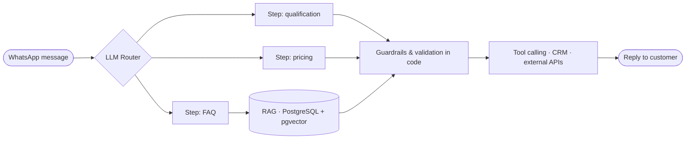

<div align="center">

<p>
  <a href="https://www.linkedin.com/in/joao-henrique-mirandamendonca-70b052322/"></a>
  <a href="mailto:jaohenrique732@gmail.com"></a>
  
</p>
</div>
<hr/>
<h2>👋 About me</h2>
 
<p>
I'm an <b>AI Engineer</b> at <b>Dryve (Finx Capital)</b> and a <b>Software Engineering</b> student at UNAERP.
I build and maintain <b>LLM-powered conversational agents that run in production</b> on WhatsApp — from agent architecture
in <b>LangGraph</b> to RAG, CRM integrations, automated tests and deployment.
</p>
<p>
I work data-first: I use metrics and real conversations to decide what to improve next, and I validate every delivery with automated tests.
</p>
```python
joao = {
    "role": "AI Engineer @ Dryve (Finx Capital)",
    "since": "Sep 2025",
    "education": "B.Sc. Software Engineering @ UNAERP",
    "focus": ["LLM agents", "RAG", "Backend (Python/FastAPI)", "Automation (n8n)"],
    "languages": ["Portuguese (native)", "English (advanced)", "Spanish (basic)"],
}
```
 
<h2>📊 Impact at a glance</h2>
 
<table>
  <tr>
    <td align="center" width="25%"><h3>17k+</h3>conversations / month handled by agents I migrated</td>
    <td align="center" width="25%"><h3>n8n → LangGraph</h3>led the migration of WhatsApp agents to Python</td>
    <td align="center" width="25%"><h3>56% → 0</h3>flow failure eliminated by moving business rules into code</td>
    <td align="center" width="25%"><h3>End-to-end</h3>collections agent built from scratch (OCR + CRM)</td>
  </tr>
</table>
<h2>🧠 How I design agents</h2>
 
<p>Agents are built as <b>state graphs</b>: an LLM router sends each message to the right step of the conversation, and each step has its own prompt and tools. Critical business rules live in code, not in the prompt.</p>

 
<h2>🔥 What I build</h2>
 
<table>
  <tr>
    <td width="50%" valign="top">
      <h3>🤖 Production LLM agents</h3>
      <p>WhatsApp customer-service agents in <b>Python + LangGraph</b>: LLM routing, per-step prompts, tool calling and guardrails. They collect and validate data, answer questions, quote prices and resume conversations automatically.</p>
    </td>
    <td width="50%" valign="top">
      <h3>💸 Collections agent</h3>
      <p>Built from scratch: negotiates payment dates, validates payment receipts with <b>OCR</b> and updates the <b>CRM</b> automatically.</p>
    </td>
  </tr>
  <tr>
    <td width="50%" valign="top">
      <h3>🔎 RAG & semantic search</h3>
      <p>Semantic search with <b>PostgreSQL + pgvector</b> to answer frequently asked questions, with the knowledge base versioned through <b>Alembic</b> migrations.</p>
    </td>
    <td width="50%" valign="top">
      <h3>🧪 Testing & quality</h3>
      <p>Automated tests that run against a <b>real LLM using production conversations</b>, plus data audits to prioritize the next fixes. I also review the team's pull requests.</p>
    </td>
  </tr>
  <tr>
    <td width="50%" valign="top">
      <h3>⚡ Automation & integrations</h3>
      <p><b>n8n</b> workflows integrated with CRM, external APIs and <b>WhatsApp Flows</b> (forms and scheduling).</p>
    </td>
    <td width="50%" valign="top">
      <h3>🚢 Shipping to production</h3>
      <p>Containerized services with <b>Docker</b>, deployed through <b>CI/CD</b> (Bitbucket Pipelines, Argo CD), with messaging over <b>RabbitMQ</b>.</p>
    </td>
  </tr>
</table>
<h2>🛠️ Tech stack</h2>
 
<p><b>AI & LLMs</b><br/>
  
  
  
  
  
  
</p>
<p><b>Backend</b><br/>
  
  
  
  
  
</p>
<p><b>Data & Infra</b><br/>
  
  
  
  
  
  
  
</p>
<p><b>Automation & Integrations</b><br/>
  
  
  
  
</p>
<p><b>Also exploring</b><br/>
  
  
</p>
<h2>🎓 Education & certifications</h2>
 
<ul>
  <li><b>B.Sc. Software Engineering</b> — UNAERP, Brazil (2026 – 2028)</li>
  <li><b>Computer Engineering</b> — UNAERP, Brazil (2023 – 2026)</li>
  <li>Certifications: LGPD (Brazilian Data Protection Law) · Information Security · Artificial Intelligence</li>
</ul>
<div align="center">

</div>
 
